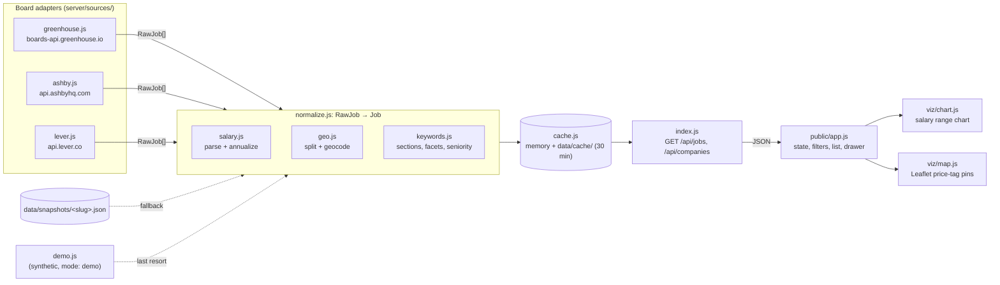

# Architecture

melon-seek is a single zero-build Node process: a tiny HTTP server that serves
`public/` as static ES modules and exposes a JSON API. The authoritative
interface definitions live in [CONTRACT.md](CONTRACT.md); this page explains how
the pieces fit together.

## Data flow

## Request lifecycle (`GET /api/jobs`)

1. `companies.js#resolveCompany` turns `?company=` or `?source=&board=` into a
   company record (built-in or custom; slugs are validated).
2. **Fresh cache** (< 30 min) → respond with `mode: "cache"`.
3. Otherwise **live fetch** via the adapter for `company.source`, normalize every
   raw job, store in cache → `mode: "live"`. `?refresh=1` skips step 2.
4. If live fails: **stale disk cache** → `mode: "cache"`, then
   **snapshot** `data/snapshots/<slug>.json` → `mode: "snapshot"`, then
   **demo** jobs → `mode: "demo"`. The failure reason is returned in `error`.

## Normalization

- **Salary** (`salary.js`): structured compensation from the source wins
  (Ashby compensation, Greenhouse pay ranges); otherwise salary text in the
  description is parsed (`$320,000—$405,000 USD`, `$310K – $385K`, `£95k-£120k`,
  `€80.000 - €100.000`, `$60/hr`). Values are annualized; `mid = (min+max)/2`.
- **Geo** (`geo.js`): raw location strings are split (`"SF | NYC"`) and matched
  against a built-in gazetteer of tech hubs, US states and countries. Remote
  entries become `{ remote: true }` locations; unknown places keep `lat/lng: null`.
- **Keywords** (`keywords.js`): description HTML is segmented into
  responsibilities and fit/requirements bullet lists, which (with title and
  department) are mapped to short facet labels — skills (`Python`, `PyTorch`),
  responsibilities (`Model training`), fit (`PhD`, `5+ yrs`). Seniority is
  inferred from the title.

## Frontend

`public/app.js` owns all state (company, chart/map mode, filters) and mirrors it
in `location.hash`. It fetches `/api/jobs`, computes facet counts, applies
filters, and pushes the filtered list into the chart and map modules, which are
pure renderers with `update / highlight / destroy` interfaces. Leaflet is served
locally from `node_modules` at `/vendor/leaflet/`; the map degrades to a plain
background if tiles can't load.

## Operations

- **Docker**: `node:22-alpine`, production deps only, runs as `node`, health
  check on `/api/companies`.
- **CI** (`.github/workflows/ci.yml`): Node 20/22 matrix, `npm test`, a check
  of the static build (`npm run build`), and a smoke test that boots the server
  and checks the API with `jq`.
- **Snapshots** (`.github/workflows/snapshot.yml`): daily `npm run snapshot`
  on GitHub runners. `data/snapshots/*.json` is uploaded as the 90-day artifact
  `job-board-snapshots` and **not committed**: one day's real snapshots are
  ~74 MB, too much to add to git history daily. Locally, `data/snapshots/` is
  gitignored.
- **GitHub Pages** (`.github/workflows/pages.yml`):
  1. Restore the latest snapshot artifact.
  2. Fetch fresh snapshots.
  3. Run `npm run build`, which writes packed job lists without descriptions,
     plus one description file per job, loaded on demand by
     `public/api.js#getJobDetail`.
  4. Deploy to `https://alvations.github.io/melon-seek/`.

  In the browser, `public/api.js` runs the live → snapshot → demo fallback
  chain itself.

## Incremental crawl and closures

Every board, stable or beta, goes through one mechanism: `server/sources/incremental.js`,
driven by `scripts/snapshot.js`. Per-board facts are in [DATA_SOURCES.md](DATA_SOURCES.md) §8;
the decisions and measurements are in [process/incremental-crawl.md](process/incremental-crawl.md).

**Every run lists the whole board.** The list (search pages, a sitemap, one API call) is
cheap and is the only way to know what is still open. What follows depends on the board:

| Kind | Boards | What the run fetches |
| --- | --- | --- |
| detail board | Apple, Google, Microsoft, NVIDIA, Netflix, Meta | the list, then a detail only for postings that are **new**, whose **change signal** moved, or whose cached detail is past its **refresh age**; every other posting reuses the previous run's raw detail |
| list-only board | Greenhouse, Ashby, Lever, Amazon | the list rows are the whole postings, so there is nothing to skip: the full list, every run (the crawl summary says `list-only`) |

- **Change signal.** One small function per adapter (`eightfoldRowKey`, `appleRowKey`,
  `googleRowKey`, `metaRowKey`): a hash (`rowKey`) of the list fields an edit or a repost moves:
  the title, places, department and dates (Eightfold `postedTs` / `t_update`, Apple
  `postingDate`, a sitemap `<lastmod>`). Volatile fields (search scores) are left out.
- **Refresh age.** A cached detail is re-fetched after at most `DETAIL_REFRESH_DAYS` = 4 days
  (`MELON_DETAIL_REFRESH_DAYS`), spread per posting over 2 to 4 days so no run re-reads a whole
  board. This catches edits the list does not show. A re-fetch is a conditional request
  (`If-None-Match` / `If-Modified-Since`) whenever the host sent a validator; a 304 confirms the
  cached detail. Sitemaps are conditional too.
- **Same output as a full crawl.** The cache holds RAW detail records, not normalized jobs:
  the adapter maps row + detail with the same code as a full crawl, and normalization runs on
  the whole board every time (it is board-wide: boilerplate paragraphs, ubiquitous keywords, the
  vetting gate; reusing normalized jobs could not be identical). `test/incremental-equivalence.test.js`
  proves snapshot, ledger and archive equality for every adapter.
- **Failures.** A failed detail reuses its cached detail only while it is within the refresh
  limit (and is retried next run); otherwise the posting has no detail, as in a full crawl. The
  failure thresholds that fail a crawl are unchanged (20% of detail requests; Meta 5% or 10 in a row).
- **Crawl state.** `MELON_CRAWL_STATE_DIR/<slug>.json.gz` (`melon-crawl-1`): `postings`
  (each posting's signature, for accounting), `listed` (every job id the run listed), and
  `adapter` (per listed id: change signal `k`, raw detail `d`, last-verified time `at`, validators
  `e`/`m`; the sitemap's entries and validators). No state, an unreadable one, another adapter
  version (`*_CRAWL_VERSION`) or `MELON_FULL_CRAWL=1` (the workflow's `full_crawl` input) means a
  full crawl, and the snapshot says why.
- **Accounting.** Each snapshot carries `crawl`: `mode` (`incremental` / `full` / `list-only`)
  and `why`; `list` `{ complete, listed, expected }`; `postings` `{ new, changed, unchanged,
  absent }`; the detail counts (`new`, `changed`, `refresh`, `reused`, `notModified`,
  `fallback`); `detailsVerifiedSince` (the oldest last-verified time of a reused detail);
  `gone` and `unpublished` job ids. Every posting is in exactly one bucket each run.

**Closures** (server/history.js `updateLedger`, `closureOptions`):

| The posting is | The ledger |
| --- | --- |
| absent from a **complete** list | closed now, `x: "absent"` |
| absent from a **partial** list (shorter than the board's own count; capped) | stays open while last seen within `UNSEEN_OPEN_DAYS` = 14, then `x: "unseen"` |
| confirmed gone: a probe got 404/410/a redirect away, or the board returned no record | closed now, `x: "gone"` |
| listed but not published (left out by the cap, a failed detail) | seen, open |
| in a failed crawl (a refused list, too many failed details) | nothing is written: snapshot, ledger and state stay as they were |

A **closure probe** is one request to the posting's own detail (Apple `jobDetails`, Eightfold
`position_details`) or page (Amazon, `HEAD`) for postings that the previous crawl listed and a
partial list did not, at most `CLOSE_PROBE_LIMIT` = 50 per board and run (`MELON_CLOSE_PROBES`),
through the same polite client (1 request/s per host, robots.txt). Only 404, 410 or a redirect
away from the posting closes; a 200, an error or a 403 leaves it open.

**In CI** (`.github/workflows/snapshot.yml`): each beta crawl restores the newest trusted
`job-board-crawl-state-beta` artifact into `data/crawl-state/`, crawls, and hands its own
`crawl-state-<slug>` to the merge; the merge overlays this run's states on the previous ones
(a crawl that did not finish keeps its previous state), records the ledger with the same
crawl's listed ids, and uploads `job-board-crawl-state-beta` (30 days). The stable job does
the same with `job-board-crawl-state`. The state is a cache, not data: the archive never
ingests it (`scripts/archive/sweep.js` lists the names it takes), and losing it costs one full crawl.
